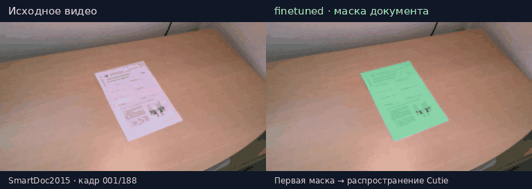
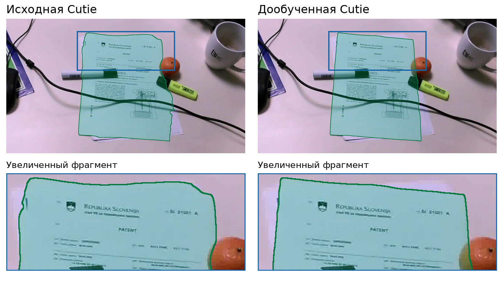

# Дообучение Cutie для сегментации документов

**Сравнение исходной Cutie и той же модели после дообучения на видео документов.**

[Результаты](#результаты) · [Установка](#установка) · [Запуск на видео](#запуск-на-видео) · [Воспроизведение](#воспроизведение-эксперимента) · [Документация](#документация)

При мобильной съёмке документа меняются перспектива, масштаб, освещение и фон;
появляются размытие и перекрытия. В этом эксперименте проверяется, насколько
дообучение [Cutie](https://github.com/hkchengrex/Cutie) на специализированных
данных улучшает выделение области документа, точность его границы и устойчивость
маски во времени.

Используется постановка **video object segmentation (VOS)**: на первом кадре
модели задаётся правильная маска документа, на следующих она строит маски
самостоятельно. Так можно оценить перенос маски и эффект дообучения отдельно
от ошибки первоначального поиска документа. Архитектура Cutie не меняется.





*SmartDoc2015, `background05/patent004` — второй худший пример исходной модели
по J&F среди 25 SmartDoc-видео валидации. Зелёным показаны предсказания.
На увеличенном кадре из отчёта Boundary IoU составляет 77,24% и 94,99%
соответственно. GIF содержит все 80 кадров последовательности; частота 10 кадров/с
задана для просмотра, поскольку исходные timestamps неизвестны.
Источник: Burie et al., SmartDoc2015, [CC BY 4.0](https://creativecommons.org/licenses/by/4.0/).
[Происхождение иллюстраций](docs/assets/README.md).*

## Эксперимент

Сравниваются две модели с общей исходной контрольной точкой:

| Модель в CLI | Веса | Описание |
|---|---|---|
| `baseline` | `cutie-base-mega.pth` | Предварительно обученная Cutie base-mega |
| `finetuned` | `cutie-document.pth` | Та же Cutie после дообучения на документах; используется по умолчанию |

Для обучения и валидации использованы **SmartDoc2015, MIDV-500, MIDV-2019,
MIDV-2020, MIDV-Holo и DLC-2021**. Размеченные четырёхугольники преобразованы
в бинарные маски. Всего — **2836 обучающих и 717 валидационных
последовательностей, 200 106 кадров**. Разбиение учитывает связанные экземпляры
документов и шаблоны, чтобы они не пересекались между выборками.
21 последовательность DLC-2021 исключена из-за пустой исходной разметки.

Дообучение начинается с исходных весов Cutie: 30 000 итераций, seed 42,
learning rate `1e-5`, batch 2, последовательность из 8 кадров, crop 480×480,
3 опорных кадра, AMP. Обрабатывается один документ без смешивания последовательностей.

Обе модели проверяются на **одних и тех же видео, кадрах и первых GT-масках**
с одинаковыми настройками памяти и инференса. Внутренний размер Cutie — 480;
предсказания сохраняются и оцениваются в исходном разрешении.
Кадр инициализации исключён из оценки.

## Результаты

Парная оценка охватывает **717 валидационных видео и 37 884 кадра после
инициализации**. Сначала метрики усредняются по кадрам видео, затем по видео
датасета и поровну по шести датасетам.

| Метрика | Base Cutie | fine-tuned Cutie |
|---|---:|---:|
| J — IoU области, % ↑ | 98,066 | **99,145** |
| DAVIS F — совпадение границ, % ↑ | 97,693 | **99,754** |
| J&F, % ↑ | 97,879 | **99,449** |
| Boundary IoU, % ↑ | 90,248 | **94,925** |
| J Decay, п.п. ↓ | 0,5482 | **0,1010** |
| Boundary IoU Decay, п.п. ↓ | 2,6124 | **0,6247** |
| Стандартное отклонение J&F внутри видео, п.п. ↓ | 1,1160 | **0,3270** |
| Средний модуль изменения J&F между соседними кадрами, п.п. ↓ | 0,4197 | **0,1661** |

Дообучение повысило J&F на **1,570 п.п.**, Boundary IoU — на **4,677 п.п.**
Прирост Boundary IoU наблюдается на каждом из шести датасетов.
Decay — разность качества в начале и конце видео: его уменьшение указывает
на меньшее накопление ошибки. Снижение разброса и соседних изменений J&F
показывает более стабильное качество масок относительно разметки.

В сохранённом запуске скорость модели составила 39,30 и 33,72 FPS,
полного прохода с чтением кадров и сохранением масок — 16,03 и 13,67 FPS
на RTX 4060 Laptop GPU с CUDA и AMP. Это измерения данного запуска;
отдельный повторяемый бенчмарк скорости не проводился. В этих исторических
результатах нет фактического CPU-профиля: их FPS несовместимы с новым
протоколом `document-vos/compute-v2` и не используются для сравнения скорости.
Метрики качества сохраняются. Общий профиль запусков — `p6-smt12`:
6 физических ядер с SMT (12 логических CPU), CPU/DataLoader workers — 6,
I/O threads — 4, PyTorch — 6 intra-op / 1 inter-op, BLAS/OpenCV и
вычислительные пулы CPU-воркеров — 1. [Границы таймеров и resume](docs/MODEL_COMPARISON.md#cpu-профиль-и-измерение-скорости).

Эксперимент выполнен с одним seed, без доверительных интервалов и оценки
на независимых съёмках. Граничные метрики не измеряют непосредственно смещение
углов или точность выравнивания страницы. При перекрытии целевая разметка
остаётся четырёхугольником документа.
Полные результаты и визуальные примеры — в [experiment_report.pdf](experiment_report.pdf),
постановка задачи — в [problem statement.md](<problem statement.md>).

## Установка

Понадобятся Git, [uv](https://docs.astral.sh/uv/getting-started/installation/)
и Python 3.12. Для основного рецепта обучения используется NVIDIA GPU;
профиль настроен на 8 ГБ VRAM. Основная платформа — Linux, для Windows
предусмотрена Ubuntu в WSL2; отдельная проверка WSL2 не выполнена.

```bash
git clone https://github.com/Misha-m-st/misis2026f-24-cv-4-makarov-m-a.git document-vos
cd document-vos
uv sync --locked
```

Зависимости устанавливаются в `.venv` из `uv.lock`, включая PyTorch 2.14.1
с CUDA 13.0. Чтение и запись видео выполняются через PyAV;
системные `ffmpeg` и `ffprobe` приложению не нужны.

### Подготовка весов и примера

> В каталогах репозитория веса `finetuned` и небольшие примеры имеют статус
> **UNPUBLISHED**: URL указывают на будущий Release. Цепочка ниже требует
> публикации этих файлов. Для уже полученных локальных пакетов используйте
> `setup --catalog models.json` и `download --sample --catalog samples.json`;
> для собственных весов у `infer` есть `--weights`.

```bash
uv run document-vos setup
uv run document-vos download --sample
uv run document-vos infer --sample
```

`setup` получает закреплённый код Cutie и веса обеих моделей.
`download --sample` загружает одну готовую валидационную последовательность
SmartDoc2015 с кадрами и первой маской — без обучающих датасетов.
`infer --sample` сохраняет PNG-маски и MP4 с наложением и выводит пути
к результатам и HTML-странице запуска.

Посмотреть объём загрузки или выбрать другой пример:

```bash
uv run document-vos download --sample --plan
uv run document-vos download --sample --dataset midv2020 --count 2
uv run document-vos infer --sample --dataset midv2020 --count 2
```

На каждый датасет предусмотрено по две фиксированные последовательности.
Эти примеры входят в валидацию эксперимента.

## Запуск на видео

Положите видео в `data/videos/`. Рядом добавьте **бинарную маску первого кадра**
либо JSON с четырьмя углами документа:

```text
data/videos/
├── example.mp4
└── example.mask.png       # либо example.corners.json
```

PNG должна быть одноканальной, совпадать с размером первого кадра после
применения поворота видео и содержать значения 0/1 или 0/255.
Углы задаются в координатах того же кадра, последовательно по контуру:

```json
[[100, 100], [900, 100], [900, 650], [100, 650]]
```

Используйте один из двух вариантов инициализации. Затем запустите:

```bash
uv run document-vos infer
```

Команда подготовит кадры и первую маску, выполнит инференс `finetuned`
и сохранит результат в новой папке `results/`. Другой каталог, исходная модель
или собственный checkpoint указываются явно:

```bash
uv run document-vos infer --input-dir "мои видео"
uv run document-vos infer --model baseline
uv run document-vos infer --weights weights/my-model.pth
```

Для повторного использования кадров можно сначала выполнить
`uv run document-vos prepare videos`, а затем передать полученную папку
в `infer --input-dir`. Автоматическая первая маска через [SAM3](docs/SAM.md)
доступна отдельно и не входит в описанную выше оценку с GT-инициализацией.

## Воспроизведение эксперимента

После подготовки кода Cutie и исходных весов получите данные и запустите
полный парный протокол:

```bash
uv run document-vos download --plan
uv run document-vos download
uv run document-vos reproduce
```

Сначала проверьте план загрузки: это полные датасеты, а обучение на
30 000 итераций — длительный запуск. Если данные уже есть, укажите их
нормализованные каталоги в `datasets.roots` файла [config.yaml](config.yaml).

`reproduce` последовательно подготавливает данные и фиксированное разбиение,
дообучает Cutie, запускает обе модели на валидации, рассчитывает метрики
и строит отчёт. Команда использует локальные входы; недостающие данные
или веса нужно получить отдельно. В `results/<запуск>/` сохраняются
конфигурация, журналы, предсказания, сравнение и отчёт.

Этапы можно запускать по отдельности:

```bash
uv run document-vos prepare datasets
uv run document-vos train
```

Основные настройки находятся в [config.yaml](config.yaml).
Приоритет — CLI → YAML → встроенные значения. Пути YAML считаются относительно
конфига, пути CLI — относительно текущей папки. `train` и `infer` допускают
изменение параметров; `reproduce` проверяет соответствие фиксированному рецепту.

```bash
uv run document-vos reproduce --resume results/ПАПКА_ЗАПУСКА
```

`--resume` проверяет входы и использует завершённые этапы.
Прерванный этап обучения запускается заново; продолжение с промежуточного
checkpoint внутри этапа не реализовано.
Подробнее — в [руководстве по воспроизведению](docs/REPRODUCING.md).

## Документация

| Документ | Содержание |
|---|---|
| [Постановка задачи](<problem statement.md>) | Исследовательский вопрос, данные и протокол сравнения |
| [Отчёт об эксперименте](experiment_report.pdf) | Метрики качества, временная устойчивость и визуальное сравнение |
| [Воспроизведение](docs/REPRODUCING.md) | Подготовка, обучение, парная оценка и продолжение запусков |
| [Датасеты](docs/DATASETS.md) | Источники, разметка и небольшие примеры |
| [Происхождение результатов](docs/REPORT.md) | Артефакты оценки и связь с весами |
| [Карточка модели](docs/MODEL_CARD.md) | Данные и ограничения дообученных весов |
| [SAM3](docs/SAM.md) | Необязательное получение первой маски |
| [Проверки](docs/VALIDATION.md) | Выполненные проверки реализации и окружения |

Справка по командам и проверки разработки:

```bash
uv run document-vos --help
uv run document-vos infer --help
uv run document-vos tools --help
uv run --extra dev ruff check src tests
uv run --extra dev pytest -q
```

## Источники и лицензии

Основа — [Cutie: Putting the Object Back into Video Object Segmentation](https://github.com/hkchengrex/Cutie)
(Ho Kei Cheng et al., CVPR 2024). Используются официальный код, архитектура
и исходные веса Cutie; специализация выполняется дополнительным обучением.

Cutie распространяется под MIT. У датасетов и необязательного SAM3 действуют
собственные условия; лицензия собственного кода `document-vos` пока не назначена.
Ссылки и атрибуция — в [THIRD_PARTY.md](docs/THIRD_PARTY.md).
